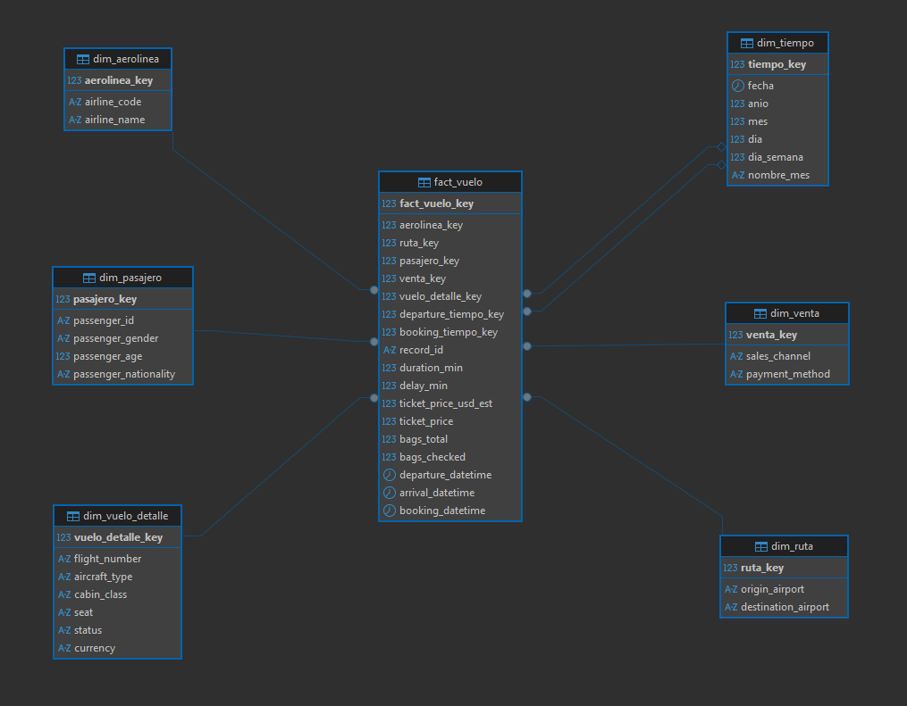
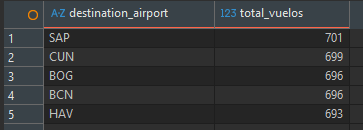
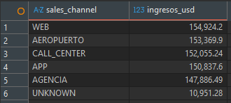
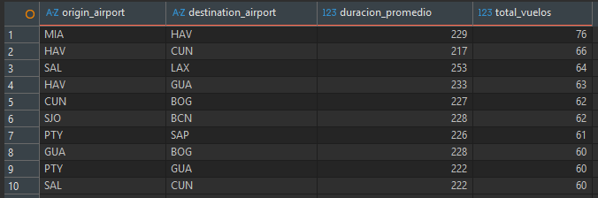
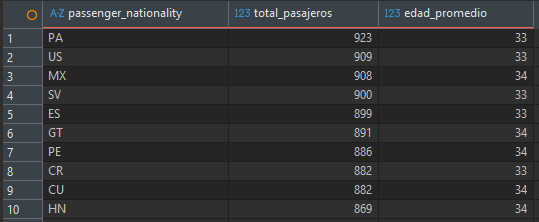
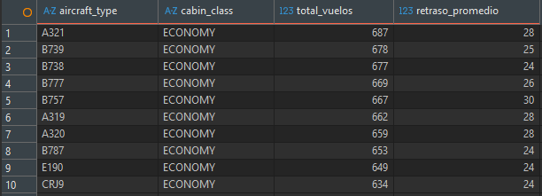
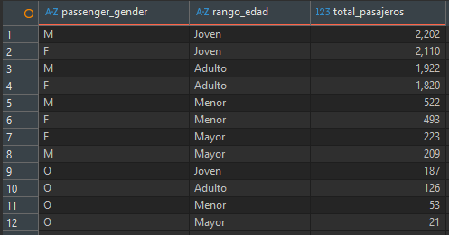
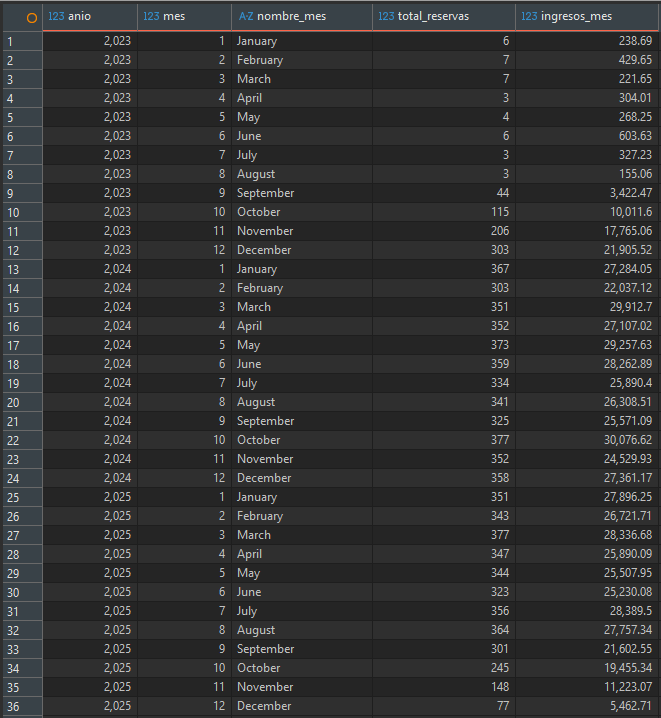

# Práctica 1

## Descripción general

En esta práctica se implementó un proceso **ETL (Extract, Transform, Load)** para cargar un dataset de vuelos en formato CSV hacia un **Data Warehouse en SQL Server**, utilizando un **modelo multidimensional en estrella**.

El proceso:
1. **Extract**: Lee el archivo CSV `dataset_vuelos_crudo.csv` con Python y pandas.
2. **Transform**:
   - Conversión de fechas a tipo `datetime`.
   - Normalización de textos (trim, mayúsculas).
   - Conversión de precios con coma a punto.
   - Conversión de columnas numéricas.
   - Manejo de valores nulos:
     - Para `sales_channel` y `payment_method` se usa el valor `UNKNOWN` para no perder registros.
   - Cálculo de campos de tiempo (año, mes, día, día de la semana).
3. **Load**:
   - Carga de dimensiones (no duplica datos si se ejecuta varias veces).
   - Carga de la tabla de hechos `fact_vuelo` usando llaves foráneas hacia las dimensiones.

---

## Diseño del modelo multidimensional (Modelo Estrella)

### Dimensiones:
- **dim_tiempo**
- **dim_aerolinea**
- **dim_ruta**
- **dim_pasajero**
- **dim_venta**
- **dim_vuelo_detalle**

### Tabla de hechos:
- **fact_vuelo** con métricas de duración, retrasos, precios y maletas, y llaves foráneas hacia todas las dimensiones.

**Modelo multidimensional:**



---

## Tecnologías utilizadas

- SQL Server 2022 (Docker)
- DBeaver
- Python 3.13
- Librerías:
  - pandas
  - sqlalchemy
  - pyodbc

---

## Preparación del entorno

### Levantar SQL Server en Docker

```bash
docker run -e "ACCEPT_EULA=Y" -e "MSSQL_SA_PASSWORD=SqlServer#2026!" -p 1433:1433 -d mcr.microsoft.com/mssql/server:2022-latest
```

**Conexion en DBeaver:**
- Host: `localhost`
- Puerto: `1433`
- Usuario: `sa`
- Contrasena: `SqlServer#2026!`

Luego ejecutar el script de creacion de tablas en DBeaver:
- `script/crearTablas.sql`

```

### Crear entorno virtual

```bash
py -m venv .venv
```

Activar el entorno:

```bash
.venv\Scripts\activate
```

### Actualizar pip

```bash
py -m pip install --upgrade pip
```

### Instalar librerías necesarias

```bash
py -m pip install pandas sqlalchemy pyodbc
```

---

## Ejecución del ETL

1. Crear la base de datos y tablas con el script SQL.
2. Verificar que el CSV esté en:
   `data\dataset_vuelos_crudo.csv`
3. Ejecutar:

```bash
py main.py
```

Resultados esperados:
- dim_tiempo ≈ 860
- dim_aerolinea = 12
- dim_ruta ≈ 210
- dim_pasajero = 10000
- dim_venta ≈ 30
- dim_vuelo_detalle = 10000
- fact_vuelo = 10000

---

## Consultas y resultados

### Total de vuelos
```sql
SELECT COUNT(*) AS total_vuelos FROM fact_vuelo;
```

### Top 5 destinos más frecuentes
```sql
SELECT TOP 5 r.destination_airport, COUNT(*) AS total_vuelos
FROM fact_vuelo f
JOIN dim_ruta r ON f.ruta_key = r.ruta_key
GROUP BY r.destination_airport
ORDER BY total_vuelos DESC;
```

### Ingresos por canal de venta
```sql
SELECT v.sales_channel, SUM(COALESCE(f.ticket_price_usd_est,0)) AS ingresos_usd
FROM fact_vuelo f
JOIN dim_venta v ON f.venta_key = v.venta_key
GROUP BY v.sales_channel
ORDER BY ingresos_usd DESC;
```

### Duración promedio de vuelos por ruta
```sql
SELECT TOP 10 
    r.origin_airport,
    r.destination_airport,
    ROUND(AVG(CAST(f.duration_min AS float)), 0) AS duracion_promedio,
    COUNT(*) AS total_vuelos
FROM fact_vuelo f
JOIN dim_ruta r ON f.ruta_key = r.ruta_key
GROUP BY r.origin_airport, r.destination_airport
ORDER BY total_vuelos DESC;
```

### Pasajeros por nacionalidad (Top 10)
```sql
SELECT TOP 10 
    p.passenger_nationality,
    COUNT(*) AS total_pasajeros,
    ROUND(AVG(CAST(p.passenger_age AS float)), 0) AS edad_promedio
FROM fact_vuelo f
JOIN dim_pasajero p ON f.pasajero_key = p.pasajero_key
WHERE p.passenger_nationality IS NOT NULL
GROUP BY p.passenger_nationality
ORDER BY total_pasajeros DESC;
```

### Aeronaves más utilizados
```sql
SELECT TOP 10
    vd.aircraft_type,
    vd.cabin_class,
    COUNT(*) AS total_vuelos,
    ROUND(AVG(CAST(f.delay_min AS float)), 0) AS retraso_promedio
FROM fact_vuelo f
JOIN dim_vuelo_detalle vd ON f.vuelo_detalle_key = vd.vuelo_detalle_key
GROUP BY vd.aircraft_type, vd.cabin_class
ORDER BY total_vuelos DESC;
```

### Pasajeros por rango de edad y género
```sql
SELECT 
    p.passenger_gender,
    CASE 
        WHEN p.passenger_age < 18 THEN 'Menor'
        WHEN p.passenger_age BETWEEN 18 AND 35 THEN 'Joven'
        WHEN p.passenger_age BETWEEN 36 AND 55 THEN 'Adulto'
        ELSE 'Mayor'
    END AS rango_edad,
    COUNT(*) AS total_pasajeros
FROM fact_vuelo f
JOIN dim_pasajero p ON f.pasajero_key = p.pasajero_key
WHERE p.passenger_age IS NOT NULL
GROUP BY p.passenger_gender, 
    CASE 
        WHEN p.passenger_age < 18 THEN 'Menor'
        WHEN p.passenger_age BETWEEN 18 AND 35 THEN 'Joven'
        WHEN p.passenger_age BETWEEN 36 AND 55 THEN 'Adulto'
        ELSE 'Mayor'
    END
ORDER BY total_pasajeros DESC;
```

### Ingresos por mes
```sql
SELECT 
    dt.anio,
    dt.mes,
    dt.nombre_mes,
    COUNT(*) AS total_reservas,
    SUM(f.ticket_price_usd_est) AS ingresos_mes
FROM fact_vuelo f
JOIN dim_tiempo dt ON f.booking_tiempo_key = dt.tiempo_key
WHERE dt.anio IS NOT NULL AND dt.mes IS NOT NULL
GROUP BY dt.anio, dt.mes, dt.nombre_mes
ORDER BY dt.anio, dt.mes;
```

---

## Resultados obtenidos:

- Total de vuelos:


- Top 5 destinos:



- Ingresos por canal:



- Duración por ruta:



- Pasajeros por nacionalidad:



- Aeronaves más utilizados:



- Pasajeros por rango de edad y género:



- Ingresos mensual:


