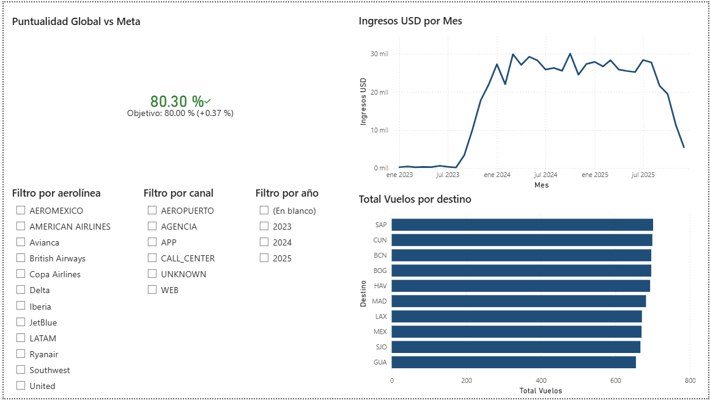
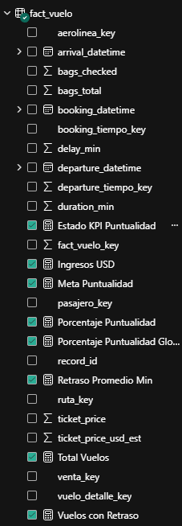
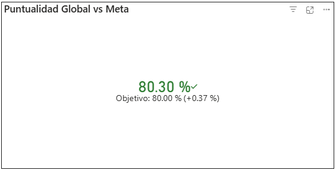
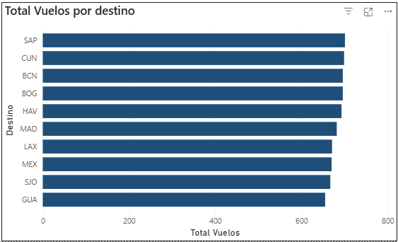
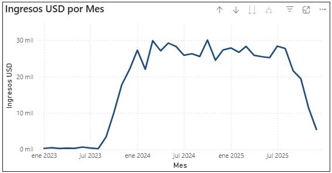
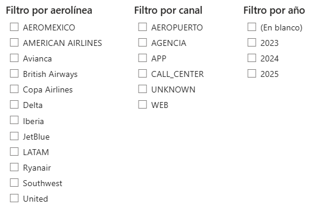

# Práctica 2

## Descripción general

En esta práctica se desarrolló un dashboard interactivo en Power BI, conectado a la base de datos SQL Server construida en la práctica 1. El objetivo fue modelar correctamente la información, crear medidas DAX y presentar KPIs para apoyar la toma de decisiones.

## Fuente de datos y conexión

- Motor: SQL Server 2022 (Docker)
- Base de datos: Practica1_Semi2
- Conector en Power BI: SQL Server
- Modo de conexión: Import

---

## Estructura del modelo tabular

### Tabla de hechos

- fact_vuelo
  - Métricas: duration_min, delay_min, ticket_price_usd_est, ticket_price, bags_total, bags_checked
  - Llaves foráneas: aerolinea_key, ruta_key, pasajero_key, venta_key, vuelo_detalle_key, booking_tiempo_key, departure_tiempo_key

### Tablas de dimensiones

- dim_tiempo
- dim_aerolinea
- dim_ruta
- dim_pasajero
- dim_venta
- dim_vuelo_detalle

### Relaciones implementadas

- dim_aerolinea[aerolinea_key] 1:* fact_vuelo[aerolinea_key]
- dim_ruta[ruta_key] 1:* fact_vuelo[ruta_key]
- dim_pasajero[pasajero_key] 1:1 fact_vuelo[pasajero_key]
- dim_venta[venta_key] 1:* fact_vuelo[venta_key]
- dim_vuelo_detalle[vuelo_detalle_key] 1:1 fact_vuelo[vuelo_detalle_key]
- dim_tiempo[tiempo_key] 1:* fact_vuelo[booking_tiempo_key]
- dim_tiempo[tiempo_key] 1:* fact_vuelo[departure_tiempo_key] (inactiva)

### Jerarquías

- Se utilizó la dimensión de tiempo para análisis temporal por año y mes.

---

## Medidas DAX creadas

### Medidas principales

```DAX
Total Vuelos = COUNTROWS(fact_vuelo)
```

```DAX
Ingresos USD = SUM(fact_vuelo[ticket_price_usd_est])
```

```DAX
Retraso Promedio Min = AVERAGE(fact_vuelo[delay_min])
```

### Medidas para KPI

```DAX
Vuelos con Retraso = CALCULATE([Total Vuelos], fact_vuelo[delay_min] > 0)
```

```DAX
Porcentaje Puntualidad = 1 - DIVIDE([Vuelos con Retraso], [Total Vuelos], 0)
```

```DAX
Meta Puntualidad = 0.80
```

```DAX
Estado KPI Puntualidad = 
IF(
    [Porcentaje Puntualidad] >= [Meta Puntualidad],
    1, 
    IF([Porcentaje Puntualidad] >= 0.75, 0, -1)
)
```

```DAX
Porcentaje Puntualidad Global KPI = 
CALCULATE(
    [Porcentaje Puntualidad], 
    REMOVEFILTERS(dim_tiempo[fecha])
)
```

---

## KPIs implementados e interpretación

### KPI principal

- Nombre: Puntualidad Global vs Meta
- Valor: Porcentaje Puntualidad Global KPI
- Objetivo: Meta Puntualidad (80%)

### Interpretación

- Si el valor es mayor o igual a 80%, la operación cumple la meta de puntualidad.
- Si el valor es menor a 80%, hay oportunidad de mejora operativa.
- El KPI permite una lectura ejecutiva rápida del desempeño general.

---

## Visualizaciones del dashboard

1. KPI de puntualidad vs meta.
2. Gráfico de barras Top 10 destinos por total de vuelos.
3. Gráfico de líneas de ingresos USD por año/mes.

---

## Segmentadores

- Año
- Aerolínea
- Canal de venta

---

## Decisiones de diseño

1. Se utilizó esquema estrella por simplicidad analítica y mejor navegación.
2. Se separaron medidas base y medidas de KPI para reutilización.
3. Se incluyó una medida global para evitar sesgo del último punto temporal en KPI.
4. Se eligieron visuales de lectura rápida para un panel ejecutivo.
5. Se agregaron segmentadores para análisis dinámico por negocio.

---

## Capturas del dashboard

### 1) Vista general



### 2) Medidas DAX creadas



### 3) KPI puntualidad vs meta



### 4) Top 10 destinos



### 5) Ingresos por año/mes



### 6) Segmentadores aplicados


