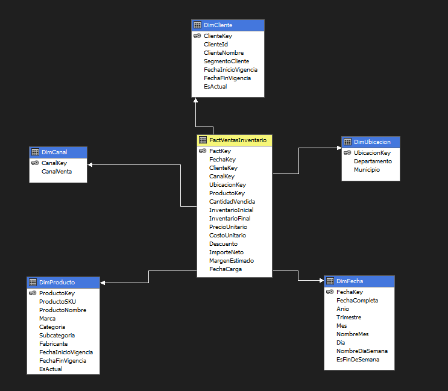
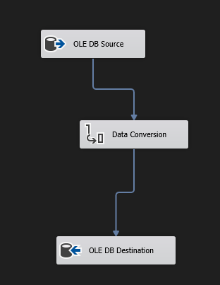
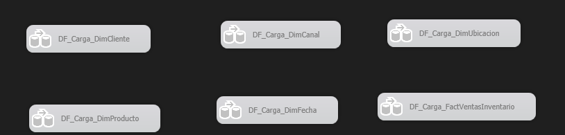
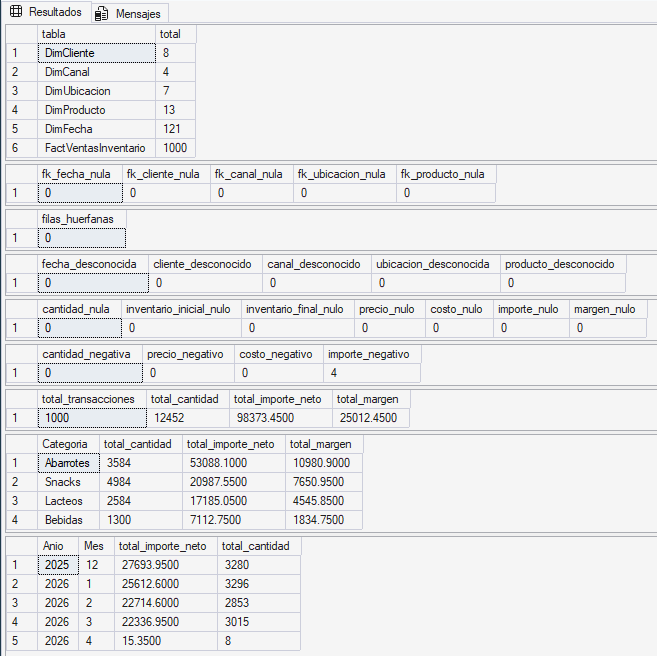
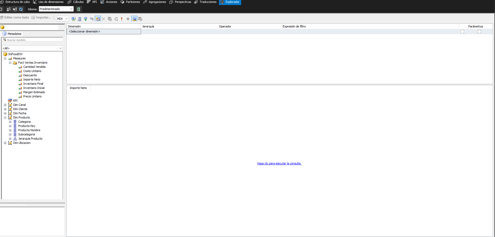
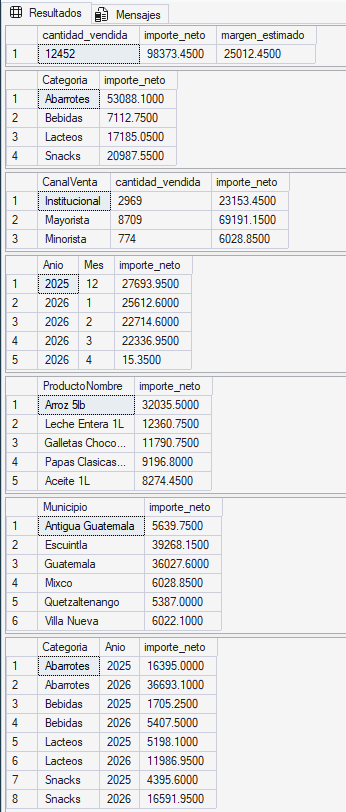

# Proyecto 1

Seminario de Sistemas 2  
Angel Arreaga  
202004762

---

## Objetivo
Implementar un flujo BI completo con:

- ETL en SSIS.
- Data Warehouse dimensional en SQL Server.
- Modelo analitico en SSAS (dimensiones, jerarquias, medidas).
- Validaciones DW y consultas MDX para comprobar resultados.

---

## Contenido del repositorio

- [ProyectoBI/Proyecto1_SGFood_BI/Proyecto1_SGFood_BI.sln](ProyectoBI/Proyecto1_SGFood_BI/Proyecto1_SGFood_BI.sln): solucion de Visual Studio.
- [ProyectoBI/Proyecto1_SGFood_BI/SGFood_ETL_SIS2/Package.dtsx](ProyectoBI/Proyecto1_SGFood_BI/SGFood_ETL_SIS2/Package.dtsx): paquete ETL.
- [ProyectoBI/Proyecto1_SGFood_BI/SGFood_SSAS_SIS2/SGFood_SSAS_SIS2.dwproj](ProyectoBI/Proyecto1_SGFood_BI/SGFood_SSAS_SIS2/SGFood_SSAS_SIS2.dwproj): proyecto SSAS.
- [sql/01_ddl_sgfood_dw.sql](sql/01_ddl_sgfood_dw.sql): creacion de SGFoodDW.
- [sql/02_validaciones_dw.sql](sql/02_validaciones_dw.sql): validaciones SQL de DW.
- [sql/03_consultas_analiticas_ssas.mdx](sql/03_consultas_analiticas_ssas.mdx): consultas MDX en SSAS.
- [imgs/](imgs): capturas de evidencia.

---

## Prerrequisitos
Instalar lo siguiente:

- Visual Studio 2022.
- Extension SQL Server Integration Services Projects para VS.
- Extension SQL Server Analysis Services Projects para VS.
- SQL Server Management Studio (SSMS).
- Docker Desktop.
- SQL Server Analysis Services.

---

## Levantar SQL Server destino con Docker
Ejecutar en PowerShell:

```powershell
docker run -e "ACCEPT_EULA=Y" -e "MSSQL_SA_PASSWORD=SGFoodSql_2026!" -p 14333:1433 --name sgfood-sql -d mcr.microsoft.com/mssql/server:2022-latest
```

Notas:

- Servidor destino del DW: localhost,14333.
- Usuario destino: sa.
- Usar la misma password configurada en el comando.

---

## Preparacion del Data Warehouse

- Abrir SSMS y conectarse a localhost,14333.
- Ejecutar [sql/01_ddl_sgfood_dw.sql](sql/01_ddl_sgfood_dw.sql).
- Confirmar que existe la base SGFoodDW y sus tablas.

---

## Abrir y configurar la solucion

- Abrir [ProyectoBI/Proyecto1_SGFood_BI/Proyecto1_SGFood_BI.sln](ProyectoBI/Proyecto1_SGFood_BI/Proyecto1_SGFood_BI.sln) en Visual Studio 2022.
- En el proyecto ETL, abrir el package [ProyectoBI/Proyecto1_SGFood_BI/SGFood_ETL_SIS2/Package.dtsx](ProyectoBI/Proyecto1_SGFood_BI/SGFood_ETL_SIS2/Package.dtsx).
- Configurar las conexiones:
   - Origen transaccional SGFoodOLTP (credenciales entregadas por el tutor).
   - Destino DW en localhost,14333, base SGFoodDW.
- Verificar que el proyecto SSAS use SGFoodDW como Data Source.

---

## Orden exacto de ejecucion

- Ejecutar cargas de dimensiones en SSIS.
- Ejecutar carga de hechos en SSIS.
- Validar DW con [sql/02_validaciones_dw.sql](sql/02_validaciones_dw.sql).
- Build del proyecto SSAS.
- Deploy y Process Full del cubo SGFoodDW.
- Ejecutar MDX de [sql/03_consultas_analiticas_ssas.mdx](sql/03_consultas_analiticas_ssas.mdx) en SSMS conectado a Analysis Services.

---

## Validacion esperada
Conteos objetivo del DW:

- DimCliente: 8
- DimCanal: 4
- DimUbicacion: 7
- DimProducto: 13
- DimFecha: 121
- FactVentasInventario: 1000

Comparacion DW vs SSAS:

- La seccion 5 de [sql/02_validaciones_dw.sql](sql/02_validaciones_dw.sql) esta en formato espejo con [sql/03_consultas_analiticas_ssas.mdx](sql/03_consultas_analiticas_ssas.mdx).
- Deben coincidir los totales por metrica y por agrupacion.

---

## Fuentes de datos usadas

- Fuente principal: base transaccional SGFoodOLTP.
- Fuente heterogenea complementaria: archivo Excel SGFood_Proyecto1_Muestra.xlsx (segun lineamientos del tutor, como apoyo de validacion o insumo ETL).

---

## Solucion de problemas frecuentes

- Error de certificado al conectar origen SQL: habilitar Trust server certificate en la conexion.
- Error de tipos Unicode/no-Unicode en SSIS: aplicar Data Conversion antes de destino/lookups.
- Duplicados por re-ejecucion: limpiar tablas de destino antes de recargar si corresponde.
- No conecta SSAS en SSMS: usar tipo de servidor Analysis Services y autenticacion Windows.

---

## Evidencias

- Modelo estrella DW.



- Flujo principal ETL.



- Carga de dimensiones.



- Validacion SQL del DW.



- Vista del cubo en SSAS.



- Ejecucion de consultas MDX.


