# Proyecto 2: Procesamiento y Análisis Exploratorio de Datos Masivos en BigQuery

## Integrantes
- Luis Emilio Rivera Yurrita -202004712
- Angel Guillermo Arreaga Barrientos - 202004762

---

## Dataset utilizado

Se utilizó el dataset público **bigquery-public-data.new_york_taxi_trips.tlc_yellow_trips_2022**


Este dataset contiene más de 100 millones de registros de viajes de taxi en la ciudad de Nueva York durante el año 2022, incluyendo información temporal, geográfica y económica de cada viaje.

---

## Exploración inicial

Se realizaron consultas iniciales para:

- Validar el acceso al dataset
- Verificar el volumen de registros
- Analizar la estructura de las columnas

Se identificaron variables clave como:

- `pickup_datetime`, `dropoff_datetime`
- `trip_distance`
- `total_amount`
- `pickup_location_id`, `dropoff_location_id`

---

## Transformación y limpieza de datos

Se creó una tabla derivada optimizada **august-outlet-493903-h3.proyecto2.trips_cleaned**

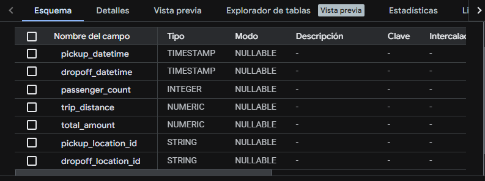

### Criterios de limpieza:

- Eliminación de registros con:
  - distancia = 0
  - monto total = 0
  - pasajeros = 0
- Validación de coherencia temporal (`dropoff_datetime > pickup_datetime`)

### Columnas seleccionadas:

- Variables temporales
- Variables económicas (`fare_amount`, `tip_amount`, `total_amount`)
- Variables geográficas (`pickup_location_id`, `dropoff_location_id`)
- Tipo de pago (`payment_type`)

---

## Optimización de consultas

Se aplicaron técnicas de optimización:

### Particionamiento
- Por fecha (`pickup_datetime`)

### Clustering
- Por ubicación:
  - `pickup_location_id`
  - `dropoff_location_id`

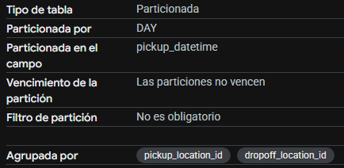

### Resultado

Se compararon consultas antes y después de la optimización, observando una reducción significativa en los bytes procesados al filtrar por rangos de fechas específicos.

**Consulta sin optimizar**

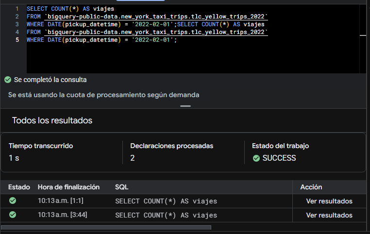

**Consulta optimizada**

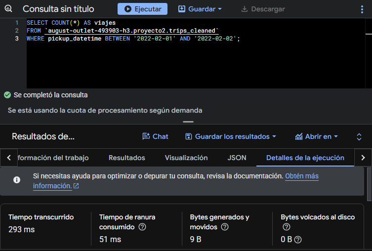

---

## Ingeniería de características

Se creó la tabla **august-outlet-493903-h3.proyecto2.trips_features**

### Variables generadas:

#### Temporales
- `hora`
- `dia_semana`
- `mes`
- `es_fin_semana`
- `parte_dia`

#### Duración
- `duracion_minutos`

#### Económicas
- `costo_por_milla`
- `porcentaje_propina`

#### Eficiencia
- `velocidad_promedio`

### Justificación

Estas variables permiten capturar patrones de comportamiento relacionados con:

- demanda por horario
- comportamiento de usuarios
- eficiencia de los viajes
- impacto del tráfico

---

## Análisis de patrones y tendencias

Se identificaron los siguientes hallazgos:

- Mayor cantidad de viajes en horas pico (mañana y tarde)
- Incremento en demanda durante fines de semana
- Variación del costo promedio según la hora del día
- Diferencias significativas entre zonas con mayor actividad
- Relación directa entre distancia y costo del viaje

---

## Preparación para modelos de Machine Learning

La tabla de features fue diseñada para facilitar el entrenamiento de modelos en BigQuery ML.

### Variables objetivo sugeridas:
- `total_amount` (regresión)
- `es_fin_semana` (clasificación)

### Variables de entrada:
- `hora`
- `dia_semana`
- `trip_distance`
- `duracion_minutos`
- `passenger_count`
- `pickup_location_id`

---

## Modelos de Machine Learning en BigQuery ML

Se entrenaron dos modelos utilizando la tabla `trips_features` como fuente de datos, reservando el 20% de los datos para evaluación mediante `data_split_eval_fraction = 0.2`, lo que previene el data leakage al separar los datos de entrenamiento y evaluación de forma aleatoria antes del entrenamiento.

### Modelo 1: Regresión Lineal (`modelo_regresion`)

**Objetivo:** Predecir el costo total del viaje (`total_amount`).

**Configuración:**
```sql
CREATE OR REPLACE MODEL `project-ad13d6df-6ba4-487d-a1e.Proyecto2SS2.modelo_regresion`
OPTIONS(
  model_type = 'linear_reg',
  input_label_cols = ['total_amount'],
  data_split_method = 'random',
  data_split_eval_fraction = 0.2
) AS
SELECT
  total_amount,
  hora,
  dia_semana,
  trip_distance,
  duracion_minutos,
  passenger_count,
  pickup_location_id
FROM `project-ad13d6df-6ba4-487d-a1e.Proyecto2SS2.trips_features`
```

**Métricas de entrenamiento:**

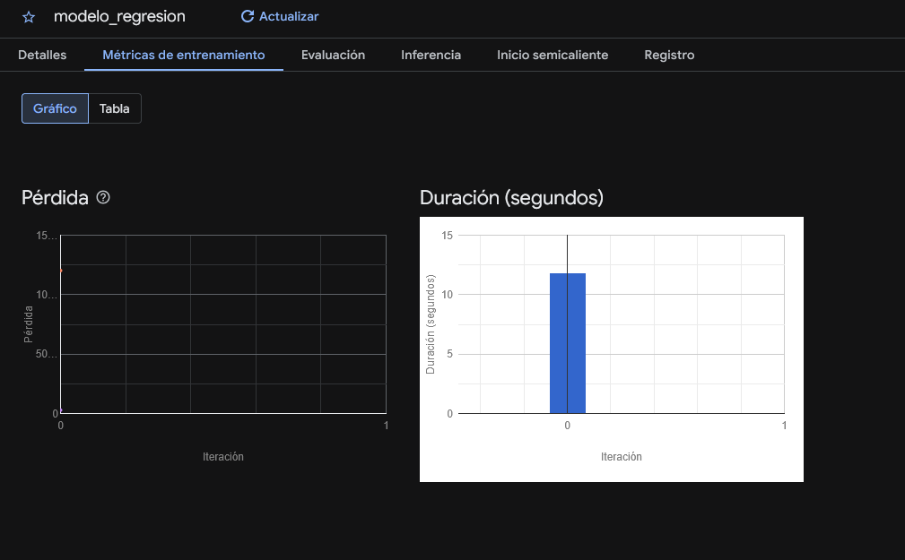

**Evaluación:**

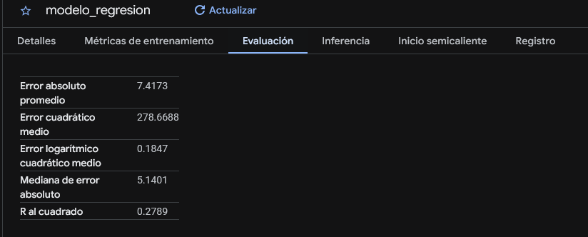

**Interpretación:** El modelo presenta un error absoluto medio de $7.42 por viaje. El R² de 0.28 indica que el modelo explica el 28% de la variación del costo total, lo cual es razonable para un modelo lineal dado que el precio de los taxis depende de múltiples factores no capturados como tarifas especiales, congestionamiento y rutas.

---

### Modelo 2: Regresión Logística (`modelo_clasificacion`)

**Objetivo:** Predecir si un viaje ocurrió en fin de semana (`es_fin_semana`).

**Configuración:**
```sql
CREATE OR REPLACE MODEL `project-ad13d6df-6ba4-487d-a1e.Proyecto2SS2.modelo_clasificacion`
OPTIONS(
  model_type = 'logistic_reg',
  input_label_cols = ['es_fin_semana'],
  data_split_method = 'random',
  data_split_eval_fraction = 0.2
) AS
SELECT
  es_fin_semana,
  hora,
  dia_semana,
  trip_distance,
  duracion_minutos,
  passenger_count,
  pickup_location_id
FROM `project-ad13d6df-6ba4-487d-a1e.Proyecto2SS2.trips_features`
```

**Métricas de entrenamiento:**

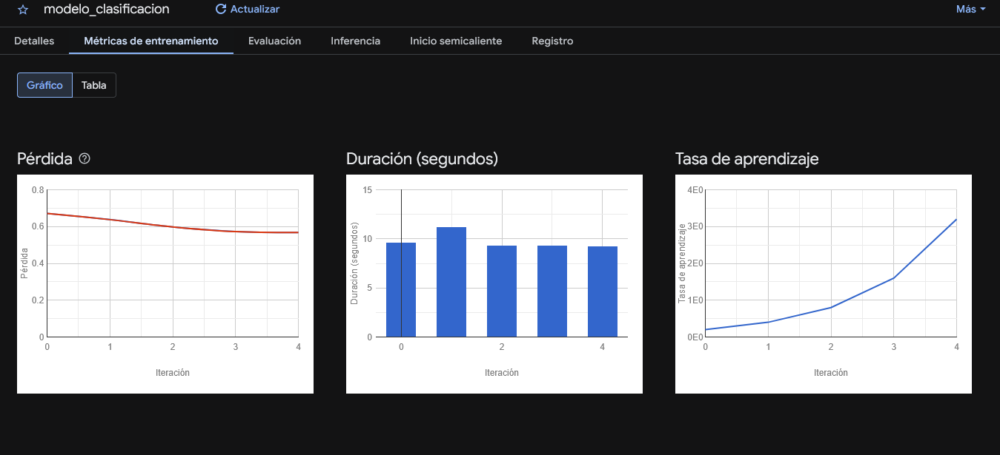

**Evaluación:**

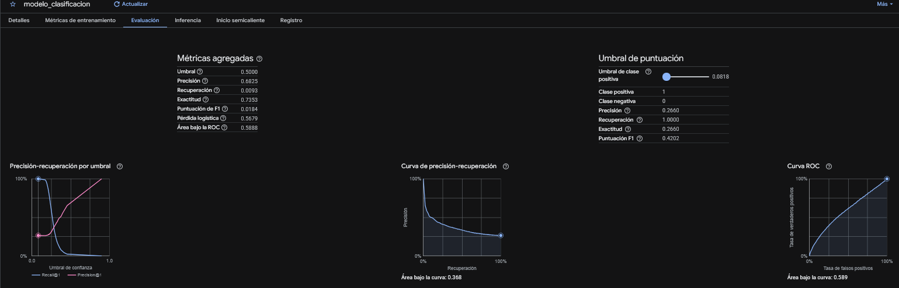

**Interpretación:** El modelo muestra una accuracy de 73.53% pero un recall muy bajo (0.93%), lo que indica que casi nunca predice correctamente los viajes de fin de semana. Esto se debe al desbalance de clases en el dataset: hay aproximadamente 5 veces más viajes entre semana que en fin de semana. El ROC-AUC de 0.589 es apenas superior al azar (0.5), lo que confirma que este modelo tiene limitaciones para esta tarea con las variables actuales.

---

## Comparación de modelos

| Aspecto | Regresión Lineal | Regresión Logística |
|---|---|---|
| Tarea | Predecir `total_amount` | Predecir `es_fin_semana` |
| Métrica principal | R² = 0.28 | ROC-AUC = 0.589 |
| Fortaleza | Captura tendencia general del costo | Alta accuracy general |
| Debilidad | No captura tarifas especiales | Dataset desbalanceado afecta recall |

El modelo de regresión tiene mejor desempeño relativo para su tarea. El modelo de clasificación se ve afectado principalmente por el desbalance entre clases.

---

## Predicciones

Se ejecutaron predicciones sobre 100 registros de la tabla `trips_features` usando `ML.PREDICT`.

**Predicciones de regresión:**

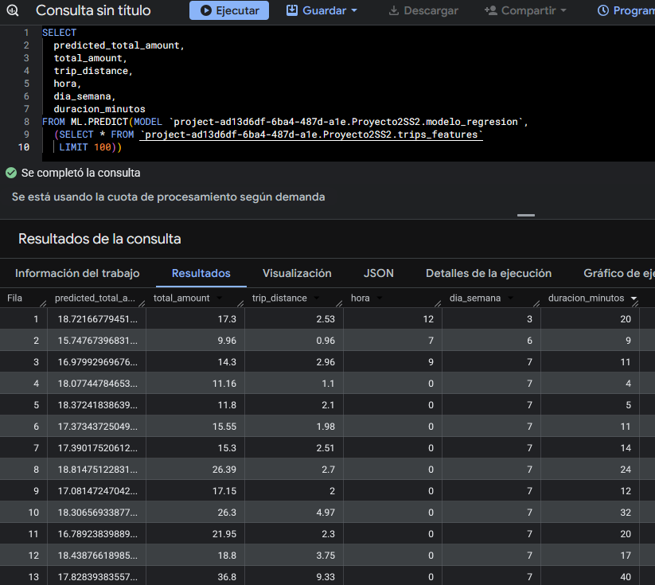

**Predicciones de clasificación:**

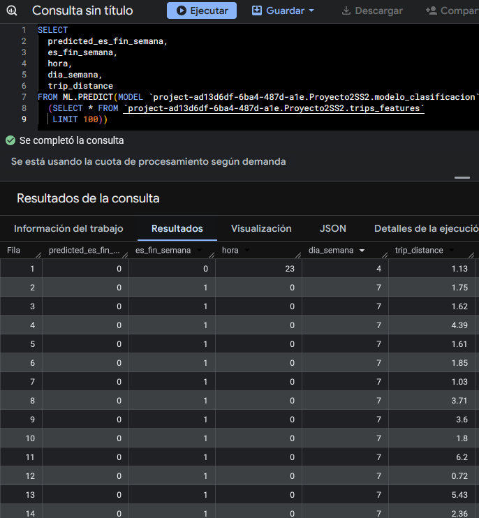

---

## Dashboard en Looker Studio

Se construyó un dashboard interactivo conectado directamente a BigQuery con las siguientes visualizaciones:

1. **Costo promedio por mes** — Gráfico de líneas que muestra la evolución del `total_amount` promedio a lo largo del año 2022.
2. **Cantidad de viajes por hora del día** — Gráfico de barras que revela los patrones de demanda horaria, con mayor actividad en horas de la tarde (17-19h).
3. **Viajes entre semana vs fin de semana** — Gráfico de barras comparativo usando `es_fin_semana`, mostrando la distribución de viajes según el tipo de día.

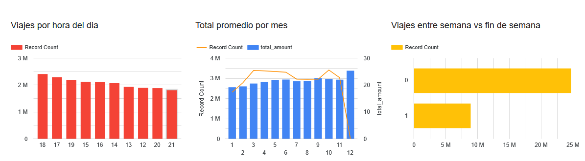

**Enlace al dashboard:** [Ver dashboard en Looker Studio](https://datastudio.google.com/s/qiparlXkaDE)