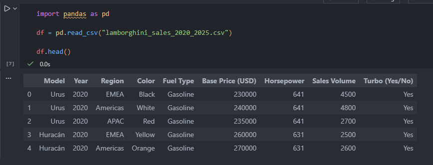
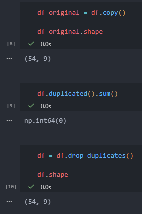
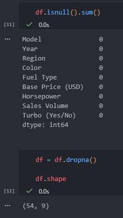
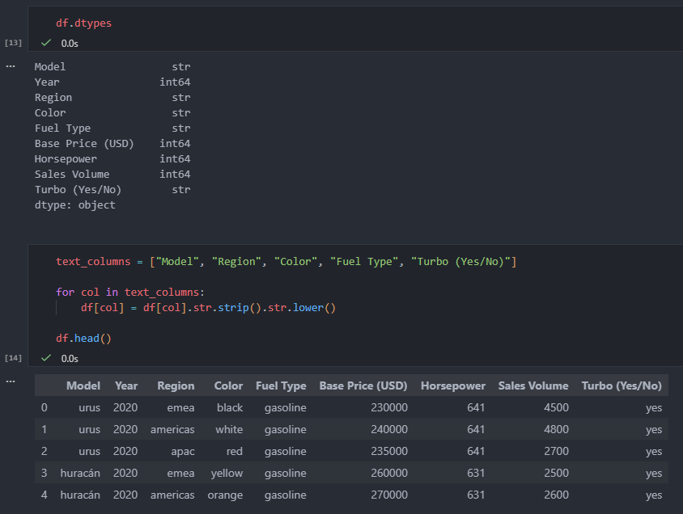
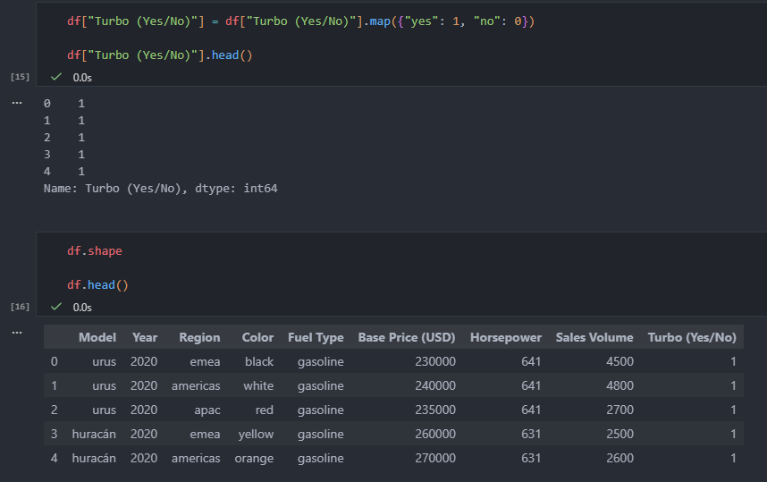
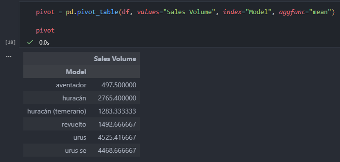
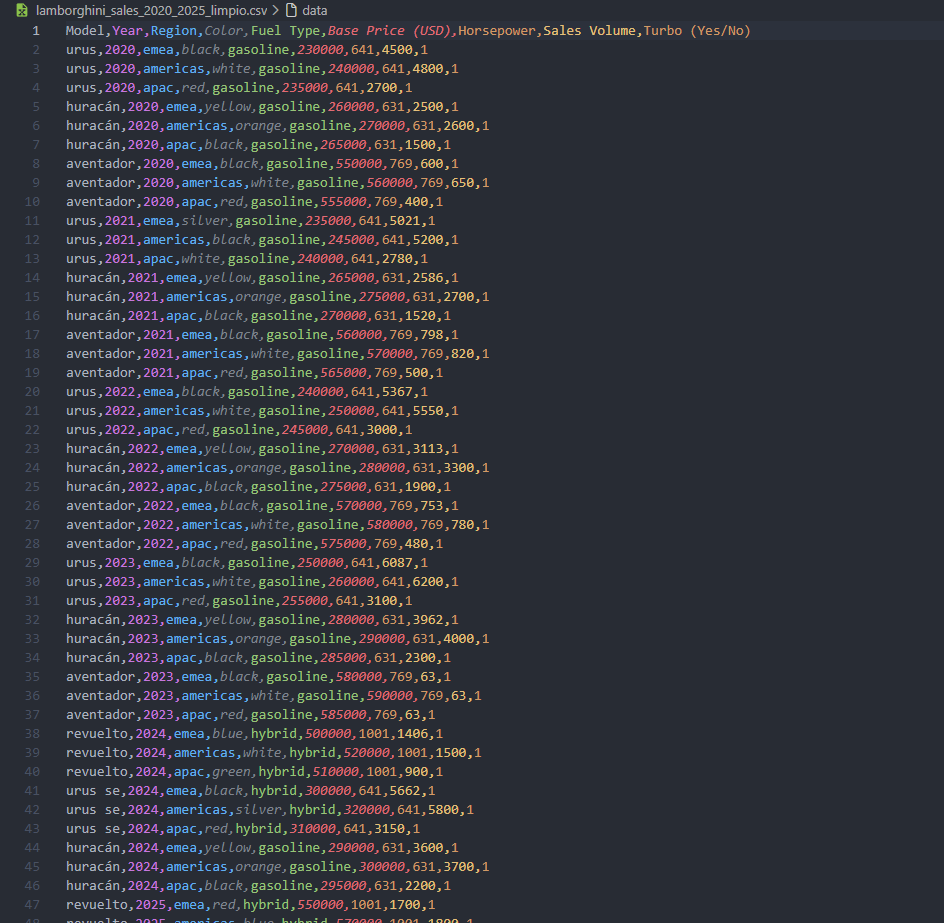

# Tarea 1 — Limpieza y análisis inicial de datos con Python y Pandas

**Curso:** Seminario de Sistemas 2  
**Estudiante:** Angel Arreaga  
**Carnet:** 202004762  

---

## Dataset utilizado

**Archivo:** `lamborghini_sales_2020_2025.csv`  
**Link del dataset:** `https://www.kaggle.com/datasets/zahranusratt/lamborghini-global-sales-dataset-20202025`

**Descripción del dataset:**  
El dataset contiene información de ventas de vehículos Lamborghini entre los años 2020 y 2025, incluyendo las siguientes columnas:
- Model
- Year
- Region
- Color
- Fuel Type
- Base Price (USD)
- Horsepower
- Sales Volume
- Turbo (Yes/No)
V
---

## Descripción del proceso de limpieza aplicado

El proceso de limpieza se realizó utilizando **Python** y la librería **Pandas** en un Jupyter Notebook (`limpieza.ipynb`). Se aplicaron los siguientes pasos:

1. **Carga del dataset original**
   - Se importó el archivo CSV con `pandas.read_csv()`.
   - Se visualizaron las primeras filas del dataset para revisar su estructura.

    

   *Foto 1:* Tabla original con `df.head()` (antes de la limpieza).

2. **Revisión y eliminación de duplicados**
   - Se verificó la existencia de registros duplicados con `df.duplicated().sum()`.
   - No se encontraron duplicados, pero se aplicó `drop_duplicates()` para dejar documentado el proceso.

    

   *Foto 2:* Resultado de `df.duplicated().sum()` y/o tamaño del dataset después de `drop_duplicates()`.

3. **Tratamiento de valores faltantes**
   - Se revisaron los valores nulos con `df.isnull().sum()`.
   - No se encontraron valores faltantes.
   - Se aplicó `dropna()` como parte del proceso estándar de limpieza.

    

   *Foto 3:* Resultado de `df.isnull().sum()` mostrando que no hay valores nulos.

4. **Estandarización de formatos**
   - Se normalizaron las columnas de texto (`Model`, `Region`, `Color`, `Fuel Type`, `Turbo (Yes/No)`):
     - Conversión a minúsculas.
     - Eliminación de espacios en blanco innecesarios.
   - La columna `Turbo (Yes/No)` fue convertida de texto (`yes` / `no`) a valores numéricos (`1` / `0`).

    

   *Foto 4:* Tabla después de la estandarización de textos (nuevo `df.head()`).  

    

   *Foto 5:* Evidencia de la columna `Turbo (Yes/No)` convertida a 1 y 0.

5. **Exportación del dataset limpio**
   - El dataset final fue guardado como:
     `lamborghini_sales_2020_2025_limpio.csv`

---

## Capturas de pantalla extra

- Foto 6: Tabla pivote

- Foto 7: Comando donde se genera el dataset limpio

- Foto 8: Dataset limpio

---

## Interpretación de los resultados obtenidos

Después del proceso de limpieza, se obtuvo un dataset consistente y estandarizado, sin registros duplicados ni valores faltantes.  
La normalización de textos asegura uniformidad en las categorías, y la conversión de la columna `Turbo (Yes/No)` a valores numéricos facilita futuros análisis estadísticos.  

La tabla pivote permite observar el comportamiento del volumen de ventas promedio por modelo, lo cual ayuda a identificar qué modelos presentan un mayor desempeño, como el Urus, o un menor desempeño, como el Aventador, en términos de ventas.

