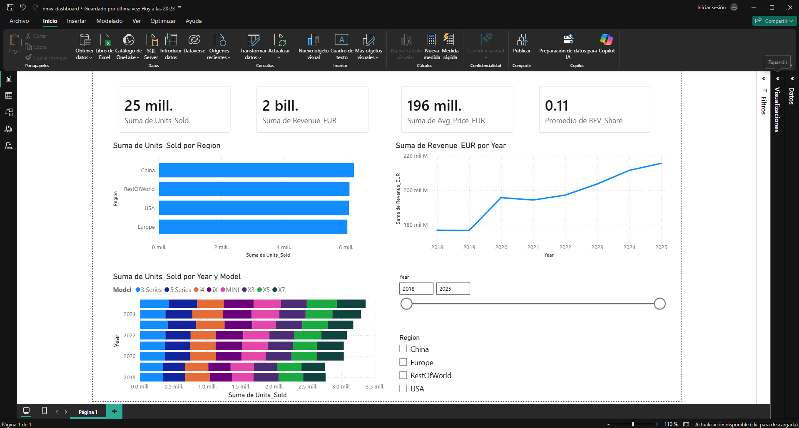

# Tarea 2
**Seminario de Sistemas 2**\
**Angel Arreaga**\
**202004762**

---

## Descripción del Dataset

El dataset utilizado es **BMW Global Sales 2018–2025**, obtenido de [Kaggle](https://www.kaggle.com/datasets/dmahajanbe23/bmw-global-automotive-sales). Contiene registros mensuales de ventas globales de vehículos BMW desde enero de 2018 hasta 2025, desglosados por región geográfica y modelo de automóvil.

| Columna | Descripción |
|---|---|
| `Year` / `Month` | Año y mes del registro |
| `Region` | Región geográfica (Europe, China, USA, RestOfWorld) |
| `Model` | Modelo del vehículo (3 Series, 5 Series, X3, X5, X7, i4, iX, MINI) |
| `Units_Sold` | Unidades vendidas en el período |
| `Avg_Price_EUR` | Precio promedio del modelo en euros |
| `Revenue_EUR` | Ingresos totales generados en euros |
| `BEV_Share` | Proporción de vehículos eléctricos de batería (BEV) |
| `Premium_Share` | Proporción de vehículos del segmento premium |
| `GDP_Growth` | Crecimiento del PIB en la región |
| `Fuel_Price_Index` | Índice de precio del combustible |

---

## Transformaciones Realizadas en Power Query

Se aplicaron las siguientes transformaciones al importar el dataset:

1. **Promoción de encabezados**: Power BI detectó automáticamente la primera fila como encabezados de columna.
2. **Definición de tipos de datos**: Se asignaron los tipos correctos a cada columna mediante la siguiente transformación:

```powerquery
= Table.TransformColumnTypes(#"Encabezados promovidos",{
    {"Year", Int64.Type},
    {"Month", Int64.Type},
    {"Region", type text},
    {"Model", type text},
    {"Units_Sold", Int64.Type},
    {"Avg_Price_EUR", Int64.Type},
    {"Revenue_EUR", Int64.Type},
    {"BEV_Share", type number},
    {"Premium_Share", type number},
    {"GDP_Growth", type number},
    {"Fuel_Price_Index", type number}
})
```

---

## Captura del Dashboard



---

## Interpretación de los KPIs

### Tarjeta 1 — Total de Unidades Vendidas: **25 mill.**
BMW vendió aproximadamente 25 millones de unidades entre 2018 y 2025 a nivel global. Esto refleja una demanda sostenida de la marca en todos los mercados.

### Tarjeta 2 — Revenue Total: **2 bill. EUR**
Los ingresos acumulados de BMW en el período analizado superan los 2 billones de euros, lo que indica una estrategia de ventas enfocada en vehículos de alto valor promedio.

### Tarjeta 3 — Precio Promedio: **63,850 EUR**
El precio promedio por vehículo refleja el posicionamiento premium de la marca. Modelos como el X7 y el iX elevan este promedio al ser los de mayor precio en el catálogo.

### Tarjeta 4 — BEV Share Promedio: **11%**
En promedio, el 11% de los vehículos vendidos por BMW en el período 2018–2025 corresponden a vehículos eléctricos de batería (BEV). Este porcentaje refleja el avance progresivo de BMW en su estrategia de electrificación, con modelos como el i4 y el iX ganando participación en los años más recientes.

### Gráfico de líneas — Tendencia de Ingresos por Año
Los ingresos anuales de BMW van de aproximadamente 175 mil millones EUR en 2018 hasta 218 mil millones EUR en 2025. Se observa un crecimiento sostenido de 2018 a 2020, una leve caída en 2021, y luego una recuperación continua hasta 2025. La caída de 2021 puede estar relacionada con la escasez global de semiconductores que afectó la producción automotriz ese año.

### Gráfico de barras — Unidades Vendidas por Región
China lidera las ventas globales de BMW, seguida por Europa, USA y RestOfWorld. Esto evidencia la importancia estratégica del mercado asiático para la marca.

### Gráfico de barras apiladas — Ventas por Modelo y Año
Los 8 modelos (3 Series, 5 Series, i4, iX, MINI, X3, X5, X7) muestran una distribución bastante uniforme entre sí, con ventas individuales que oscilan entre 317 mil y 460 mil unidades por modelo por año. Las ventas totales anuales crecieron de aproximadamente 2.7 millones en 2018 a 3.5 millones en 2024, lo que evidencia un crecimiento sostenido de la marca a lo largo del período analizado.

---